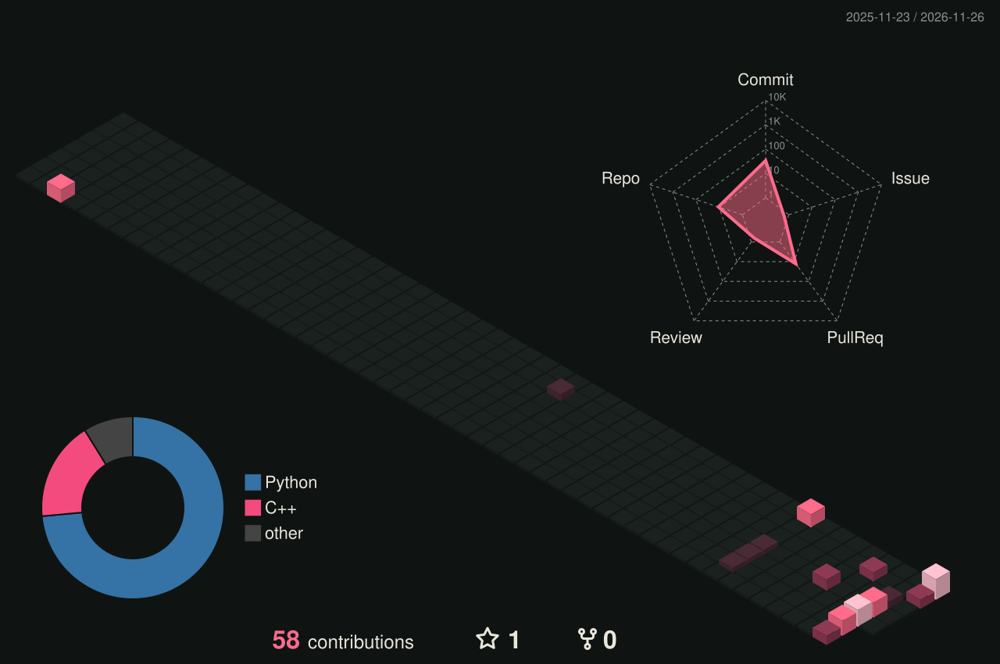

 

 

[mcp-booking-server](https://github.com/hrshchouhan/mcp-booking-server), [opportunity-scanner](https://github.com/hrshchouhan/opportunity-scanner), [Cataclysm-BN](https://github.com/hrshchouhan/Cataclysm-BN)

 

 

Write to me at [hrshvardhanchouhan@gmail.com](mailto:hrshvardhanchouhan@gmail.com).
