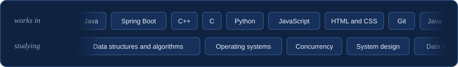
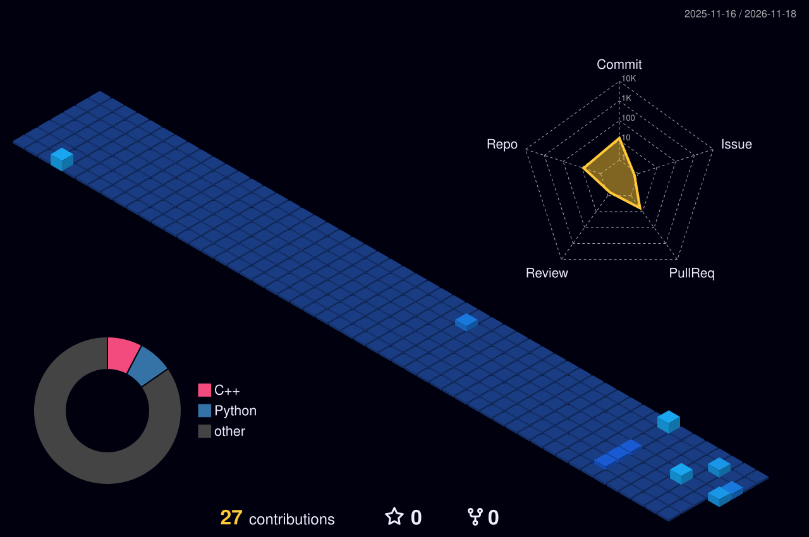

  

 

  

 

### Currently building

| Project | What it is |
| :-- | :-- |
| [mcp-booking-server](https://github.com/hrshchouhan/mcp-booking-server) | Booking tools exposed over the Model Context Protocol. |
| [opportunity-scanner](https://github.com/hrshchouhan/opportunity-scanner) | A nightly scanner that finds GitHub bounties and good-first-issue listings. Python. |
| [Cataclysm-BN](https://github.com/hrshchouhan/Cataclysm-BN) | My fork, where I work on fixes to send upstream. C++. |

### Tools and topics

  

### Contribution graph

  

 

Open to freelance work and open source collaboration. Write to me at [hrshvardhanchouhan@gmail.com](mailto:hrshvardhanchouhan@gmail.com).
